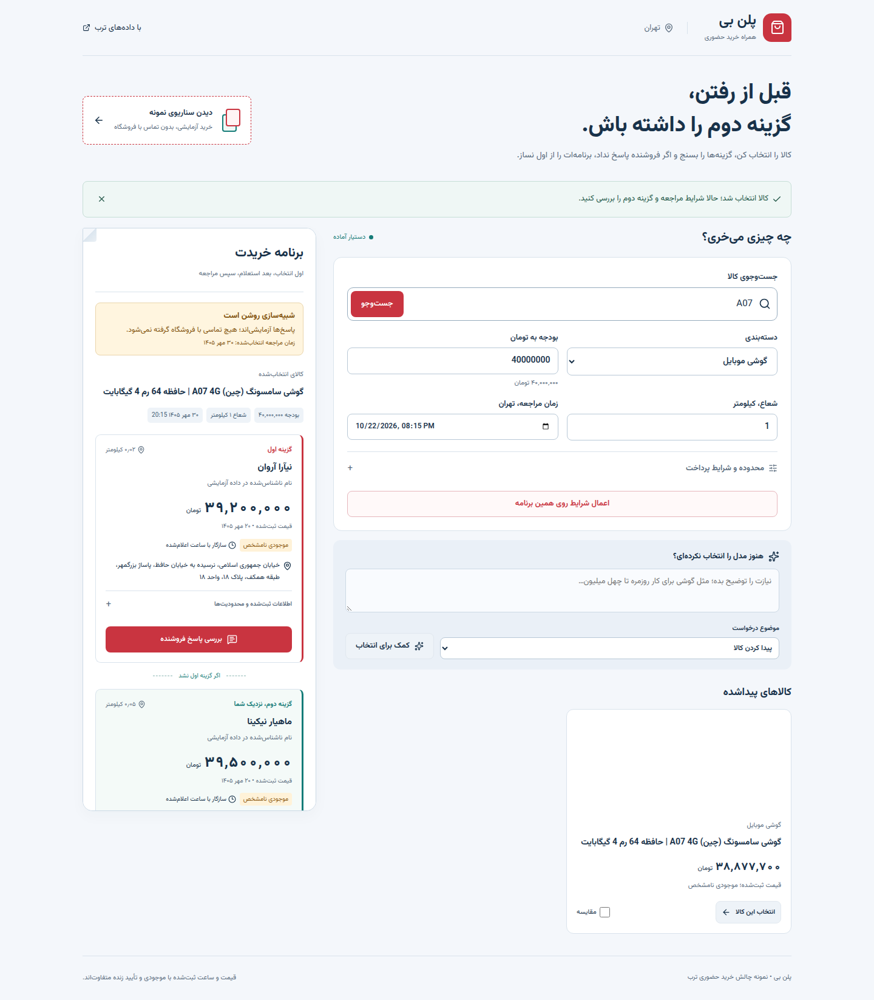
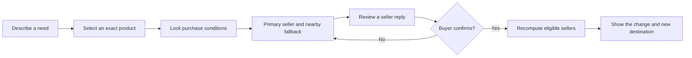

# Plan B before you leave

**An in-person purchase plan that survives a seller saying no.**

Persian · RTL · Torob dataset · FastAPI · React · Isolated Codex worker

[Try it locally](docs/getting-started.md) · [User guide](docs/user-guide.md) · [Architecture](docs/architecture.md) · [Results](docs/evaluation.md)

---

A low price is only useful if the right product, shop, budget and visit time work together. Plan B helps a buyer choose an exact product, prepare a nearby alternative, and recover when a seller is unavailable or changes terms—without entering the same requirements again.

> [!IMPORTANT]
> **Verified locally; public hosting is pending.** The catalogue, shopping journey, genuine local Codex calls and container persistence have been exercised. Prices are historical, stock is unknown, and the sample seller replies are simulated. No seller is contacted automatically. [Current delivery state](docs/insured-vibe-coding/kanban.md).

*Actual local interface. The highlighted sample uses catalogue rows and clearly labelled simulated replies.*

## Start with your goal

| You want to… | Read |
|---|---|
| Understand the product in two minutes | This page, then [the user journey](docs/user-guide.md) |
| Run the application | [Getting started](docs/getting-started.md) |
| Assess the engineering and AI boundary | [Architecture](docs/architecture.md) and [model runtime](docs/model-runtime.md) |
| Review measured outcomes | [Evaluation and evidence](docs/evaluation.md) |
| Record the five-minute demonstration | [Demo sequence](docs/demo.md) |
| Check deployment or submission readiness | [Deployment](docs/deployment.md) and [submission evidence](submission.md) |
| Find a setting, endpoint or recovery step | [Configuration and API reference](docs/reference.md) |

[Browse the documentation](docs/README.md) for the complete reading map.

## The product loop

| Capability | What the buyer gains | Boundary |
|---|---|---|
| Search and AI-assisted discovery | Source-backed product choices and two-product comparison | Missing specifications remain unknown |
| Purchase mission | One place for exact model, budget, location, visit time and payment constraints | Constraints change only through explicit user action |
| Nearby fallback | A separate eligible shop for the same product | Normally within 500 metres straight-line of the primary; not a walking-time estimate |
| Reply preview and confirmation | Inspect what a reply means before it affects the plan | User-reported or simulated; never independently verified stock |
| Deterministic recovery | Promote another option and explain the price delta | Works without the model; no silent budget or variant substitution |
| User-clicked handoffs | Exact-model Torob search and destination options | No live stock query, ride booking, fare calculation or credit approval |

## A concrete recovery

The repeatable sample uses a **40,000,000-toman budget**, a **1 km radius**, and a fixed **22 October 2026, 20:15 Tehran** visit.

| Before the reply | After confirming unavailable |
|---|---|
| Primary: 39,200,000 toman | Previous fallback becomes primary: 39,500,000 toman |
| Nearby fallback: another shop, about 63 m from the primary | Visible increase: **300,000 toman** |
| Exact product and visit conditions selected | The same product, budget, radius and visit time remain locked |

These are historical catalogue offers, not current availability or a real shopping appointment. See the [screen-by-screen walkthrough](docs/user-guide.md#practice-the-complete-recovery).

## Data and AI responsibilities

| Application code decides | Codex assists with |
|---|---|
| Exact money, eligibility, hours, geometry, ownership and mission revisions | Persian needs interpretation |
| Which shop can be a primary or independent fallback | Explaining retrieved products with validated source facts |
| Applying confirmed observations and calculating changes | Interpreting a pasted seller reply for review |

The mandatory catalogue contains **6,476 shops**, **225,903 products** and **331,506 offers**. It is imported from the organizer's archive and is not redistributed in this public source repository. [Setup and data requirements](docs/getting-started.md).

Codex authentication stays on the local worker. The model receives bounded evidence and returns schema-validated output; it cannot directly change a mission, run SQL, contact a shop or access application credentials. [Runtime design](docs/model-runtime.md).

## Evidence and current limits

Recorded checks include **186 backend tests**, **23 independent rendered UI scenarios**, real model/mission API checks, an eight-case recovery evaluation, and a constrained local container run with restart persistence. These are recorded development results, not a CI badge or proof of live shopping success. [Read the evidence and its scope](docs/evaluation.md).

<strong>What this MVP deliberately does not claim</strong>

- Current prices, verified stock, authentic-brand verification or seller identity verification.
- Automated calls/messages, a reservation, financing approval or a booked ride.
- Route duration or a stock probability inferred from a recorded offer.
- Uninterrupted hosted AI: a local outbound worker supplies model access.
- Completed public deployment, final video or contest submission.

The supplied phone numbers are synthetic. [Seller-contact boundaries](docs/contact-limitations.md) explain how assisted follow-up stays honest.

## Attribution

Challenge and mandatory dataset: Torob / Starcoach Agentic AI Hackathon 2026. The bundled Vazirmatn font includes its [OFL 1.1 license](frontend/public/fonts/OFL.txt). Python and frontend dependencies are recorded in the lockfiles; no additional project-wide license grant is implied here.
