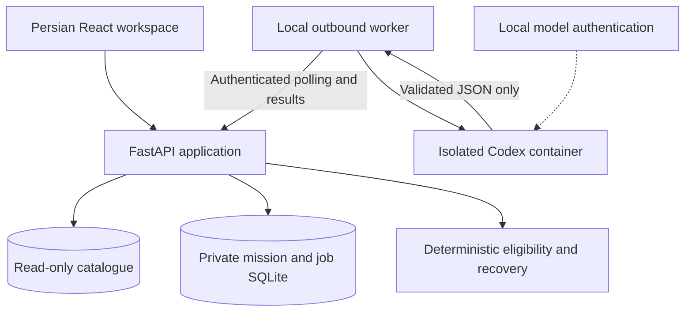
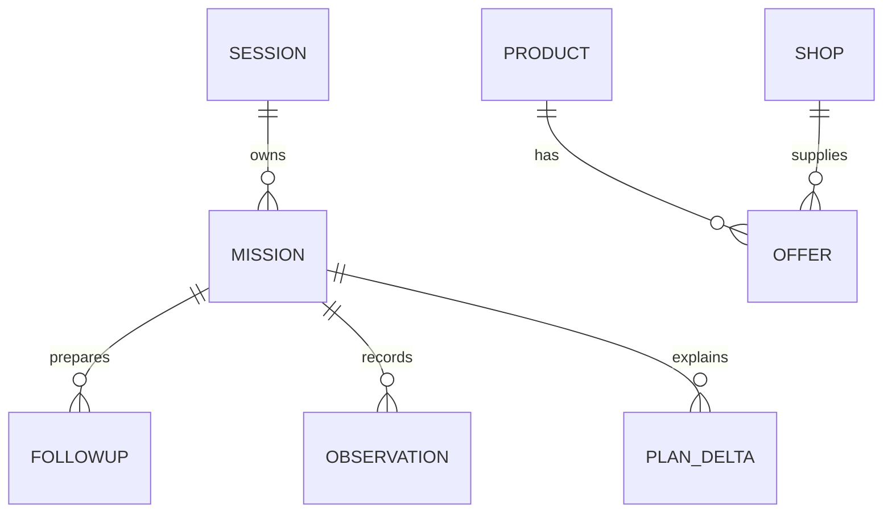

# Architecture and evidence boundaries

[← Documentation](README.md) · [API/configuration](reference.md) · [Evidence](evaluation.md)

## Component map

The diagram shows the application components; the proposed hosted app and local worker have separate acceptance gates. The application has no model authentication, and the model has no application database or worker bearer.

## Application and catalogue

The browser renders a Persian RTL purchase workspace. FastAPI serves its compiled assets, public catalogue queries and private mission APIs. A read-only SQLite FTS catalogue contains the complete supplied CSV payloads. A separate persistent SQLite database owns signed-cookie sessions, mission revisions, follow-ups, append-only observations and model jobs. Run exactly one application replica; SQLite and the in-process request limiter are not a multi-replica design.

## Decision flow

An exact search or AI-assisted needs request retrieves source products. The buyer selects one exact product and explicitly sets budget, radius, visit time and payment requirements. Python classifies every offer as candidate, needs verification or ineligible. The shortlist combines up to30 cheapest and30 nearest distinct shops. The primary defaults to cheapest eligible; a fallback must be another eligible shop for the same product within500metres straight-line. UI comparisons also expose source specs, prices, declared hours and missing facts.

A follow-up is an inquiry draft, never an outbound message. Manual outcomes and AI-interpreted replies create stored previews. Confirmation checks the owning session and expected mission revision, applies scoped observations transactionally, and returns the revised plan and exact price delta. No-response remains unknown. A later explicit confirmed reply can supersede it. Rechecks remain reachable even when all original candidates are exhausted. Simulation and assisted missions are separate records; only an owning simulation can reset its observations.

## Model boundary

The application queues bounded JSON requests. A local outbound worker polls the application, runs Codex CLI in an isolated container, and submits typed results using a private bearer token. See [model runtime](model-runtime.md) for limits and isolation. The hosted application never stores Codex authentication. The model cannot execute catalogue SQL, contact sellers, mutate missions or see executor credentials. Retrieved IDs and each cited fact are checked before presentation. Numeric product facts are rendered from catalogue values, not accepted as model-written facts. Proposals require an explicit user action.

Model calls are genuinely useful for Persian need interpretation, retrieved-product explanation and reply interpretation. Search, eligibility, exact money, geometry and recovery work without the model. Cancellation invalidates the browser request generation as well as the server job; a delayed initial response cannot overwrite newer work. The worker is a local availability dependency, not unattended hosted inference. OmniRoute is only a conditionally authorized alternative; this build has not switched providers.

## Logical state relationships

This is a logical relationship map, not a migration or complete SQL schema. Catalogue facts are immutable inputs; session observations and plan deltas live in separate private state. A duplicate offer at one shop is not an independent backup shop.

## Comparison provenance and failure states

The comparison keeps authoritative global product prices separate from the condition-compatible offer. A contact-filtered search card cannot supply the global-minimum row. Loading, failed lookup and a successful zero-candidate result are distinct states; retry reuses an unchanged product/constraint snapshot. A failed read never establishes absence of a seller.

A small exact alias dictionary aligns RAM/internal-storage capacity labels with identical declared unit families (GB, MB or TB), preserving original source labels and values. It does not convert units or conflate RAM type, storage type, operating-system version, unknown units or unsupported labels. Unknown capabilities are never inferred from the title. The readable source-point label is an additive bounded constraint field; coordinate edits clear a stale draft label, and mission restoration preserves explicit hours opt-out and prior constraints.

## Storage and deployment

The private image contains the validated catalogue at `/app/data/catalogue.sqlite`; this file is opened read-only/immutable and never served as an HTTP asset. Mount persistent state at `/data/state.sqlite`. `/healthz` checks process liveness; `/readyz` checks the actual catalogue manifest/index availability. HTTPS makes the opaque session cookie Secure; session mutations require the configured exact origin. Browser assets contain no worker/session secrets. The local container was exercised with512MiB/0.5CPU; exact measurements and restart evidence are in [container.json](qa-evidence/container.json). A cloud URL and hosted-worker acceptance remain separate pending gates.

## Limitations

Prices can be stale and stock is unknown. Most shop names and all supplied phone numbers are synthetic. Only provided website/Instagram routes can be handed to the buyer; no synthetic telephone number is actionable. A user-reported reply is not independently verified. No route duration, fare, credit eligibility, authentic-brand guarantee, stock probability or reservation is computed. The catalogue is not live Torob search. External actions open Torob, TorobPay or navigation/ride sites only after a user click; no transaction is performed.

The source dataset has extreme price anomalies, two empty product titles and missing prices/hours/payment evidence. Values remain exact decimal strings; flagged or unknown prices do not qualify as cheap offers. Unknown required facts do not become affirmative eligibility. When no candidate remains, the planner can propose the smallest sufficient budget increase or radius increase, one field at a time. It recomputes eligibility from all effective source offers and scoped observations, preserves the exact product and every other constraint, and returns supporting offer IDs plus the base revision. Missing facts, multiple conflicts, reported unavailability and payment/contact restrictions cannot be bypassed. Applying is an explicit revision-checked condition update. Embeddings, basket planning, live seller automation and payment/ride APIs remain out of scope.

## Bounded discovery continuation

An optional `discovery_parent_turn_id` binds a follow-up to the exact owned completed discovery result that supplied the visible cards. It cannot reference another session, failed/canceled/reply/mission-bound/empty result or a parent older than the assistant-selected1800-second limit. The full typed displayed source-card snapshot, including its original filtered price and offer evidence, is retained separately. One terminal result projection returns all snapshots for clarification/degradation or selects them in requested order for an exact-reference comparison; source-existence reads never replace a card’s original price scope. Successful fresh retrieval remains a distinct output. only the first six cards enter the model allowlist with display positions, bounded identity and source RAM/storage/price facts. Recommendation order is not used. Failed/reply messages are excluded from the bounded previous-message payload.

Context-bearing interpretation uses a dynamic catalogue-ID allowlist and `torob-context-v1` provenance. A comparison of prior references fetches those exact products and returns a typed comparison action; it does not re-search guessed names, change conditions or mutate an owned mission. Missing/unavailable ordinal references clarify rather than fall through to new search. ASCII, Persian and Arabic numeric card positions normalize to the same exact indices. Recognized same-model requests require a correct source binding; an absent binding cannot become a fresh accessory search. Related searches stay in the known model/brand/category family, while ambiguous memory asks RAM versus internal storage. Source variants remain explicit buyer selections.

The browser clears continuation on manual/sample/result replacement, including delayed-response interleavings. Manual search, diagnostic acceptance and sample loading invalidate pending agent turns before replacing cards; a late old response cannot regain its parent. It exposes an ordinary comparison component through a deliberate button; model output never becomes arbitrary HTML, navigation or tools. [Verification](qa-evidence/discovery-context.json) separates deterministic protocol-fixture acceptance from genuine live-model acceptance.

## Owned-turn read recovery

The browser binds polling to one owned turn ID and the original monotonic120-second request deadline. At most three read retries are shared across the whole turn, only for transport failures orHTTP502/503/504; cancellation and the interaction epoch are checked before/after each read and backoff. The in-flight read is aborted at the original deadline. Turn creation, observation confirmation and other writes remain single-attempt operations; authentication, ownership, revision, rate-limit and application errors never trigger this recovery. A completed typed result can therefore survive a dropped response without starting or replaying inference.
