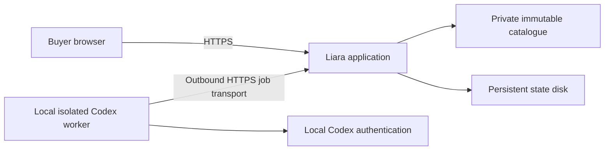

# Actual HTTPS deployment

[← Documentation](README.md) · [User guide](user-guide.md) · [Getting started](getting-started.md)

The full-catalogue application is live at **https://torob-plan-b-2026.liara.run**. It uses one disposable Liara application, an isolated contest network and a persistent state disk. Codex authentication stays on the local outbound worker; it is never uploaded to Liara.

| Part | Demonstrated configuration | Evidence |
|---|---|---|
| Public application | Docker, one replica, port8000;512MiB/0.5CPU base plan | [Actual hosted acceptance](insured-vibe-coding/test-plans/hosted.md) |
| Catalogue | Private immutable image;6,476shops/225,903products/331,506offers | [Packaging](packaging.md) and [artifact manifest](qa-evidence/deployment-artifact.json) |
| State |1GB disk named `state`, mounted at `/data` | [Hosted recovery](qa-evidence/hosted-offline.json) |
| Model | Managed local worker, outbound HTTPS to the hosted job queue | [Genuine needs/reply](qa-evidence/hosted-model.json) and [reconnection](qa-evidence/hosted-reconnect.json) |
| Browser boundary | Secure/HttpOnly/SameSite=Strict cookie, independent-session404, wrong-origin403, private paths404 | [Hosted boundary checks](qa-evidence/hosted-offline.json) |

## What was actually exercised

Actual HTTPS acceptance covers the source-data purchase scenario, manual recovery with the worker disconnected, a genuine Persian needs request, genuine interpretation of an explicitly simulated seller reply, preview before confirmation, exact300000toman fallback delta, mobile layout and session/origin isolation. Deliberate worker disconnection was followed by a fresh genuine request after reconnection. These are narrow recorded runs, not continuous-availability or concurrency guarantees.

The provider accepted a single restart request with HTTP200, and the existing session/mission remained readable. Its history response did not independently establish that a container restarted. [The restart record](qa-evidence/hosted-restart-result.json) therefore remains **partial**, rather than promoting HTTP continuity to proof of a restart. The separately recorded [version-transition test](qa-evidence/hosted-version-transition.json) owns the subsequent source-version/state-continuity result; an awaiting or failed record is not a pass.

## Current delivered version and paused source checkpoint

Release `6adb3fbe417e33237eed81ba` serves source `4ddab1a` / conversational frontend `1df525d`. The315502-byte private source uses a build-stage download of the exact organizer archive and verifies its archive hash, three CSV payload hashes and full counts. It downloads or rebuilds nothing on runtime restart. [Actual hosted acceptance](qa-evidence/hosted-conversation-r2.json) covers saved-session continuity, real map tiles, explicit300000-toman recovery and mobile rendering; it made zero new model calls. Original large upload outcomes remain private, unknown and unreferenced.

The user requested a pause after verified source `5119f12` on `usability/r2a-torob`. That newer semantic-continuation/mobile revision has not been packaged, deployed, tested with genuine inference or rescored. [Its checkpoint](qa-evidence/r2a/checkpoint.json) and [resume gates](qa-evidence/r2a/resume-after-user-checkpoint.md) govern continuation. Keep this deployed-artifact manifest separate from the newer source.

## Reproducible private source packaging

Build the catalogue and frontend using [getting started](getting-started.md), then use the allowlisted packaging script. The current compact mode fetches and validates the pinned organizer dataset only during image build. The earlier complete-CSV and compressed-SQLite/XZ modes remain documented alternatives; their transport hashes and semantic-equivalence evidence stay distinct. The private source artifact is below the provider's128MB upload limit. State, private environment files, personal records and Codex authentication are excluded. The final image contains the mandatory catalogue and must not be pushed to a public image registry.

An initial144MB archive was rejected at upload. A later archive exposed a legacy-builder incompatibility with `COPY --chmod`; the corrected Dockerfile uses ordinary `COPY` plus `RUN chmod`. These failures and the successful actual legacy build are retained in [packaging evidence](qa-evidence/packaging-legacy-compatibility.json). Runtime startup prepares only the opened state directory, then drops to UID/GID10001 with zero effective capabilities and `NoNewPrivs=1`. Both constrained named-volume and root-owned-bind local acceptance passed.

`docker compose up -d` remains the local container route. Set a private generated session secret, worker token and exact public origin for that environment; do not reuse cloud credentials. The local Compose URL is `http://127.0.0.1:8652`; the development app uses8651. The worker must target the same chosen application URL.

## Local review runtime at the pause

The current loopback mirror is `http://127.0.0.1:8651`, managed by `starcoach-torob-preview.service` and `starcoach-torob-preview-worker.service`, using the existing private `.env` and local state. Its canonical frontend/runtime remains the earlier accepted conversation revision; the R2a scratch build was deliberately not promoted. The separate `starcoach-torob-model-worker.service` still serves the public hosted app. All model workers and the private Liara operator share the same persistent100-start rolling24-hour gate and single-process lock; no quota was reset or raised. Keep credentials and private state out of source. Isolated deterministic QA servers were stopped; these intended user runtimes were retained.

## Resource scope and lifecycle

The inspected base/basic plan quote was1146toman/hour includingVAT:55008toman for48hours for this app. Combined with the two disposable Liara scenario services, the quoted total is165024toman, within the reviewed200000toman scope. Quotes are not measured charges, a guarantee about retained-disk billing or a current balance. No personal top-up, plan upgrade or unrelated application overwrite was performed.

A best-effort local timer is armed for25October2026 at00:00UTC to request scale zero for only the three recorded disposable app IDs, preserving data. It depends on this workstation/session/network and is not a provider-enforced billing cap. The managed local worker also depends on this workstation and its authenticated Codex session. Deterministic search/recovery remains usable when the worker is unavailable; hosted AI is not promised to be always on.

Sources: [Docker deployment](https://docs.liara.ir/paas/docker/how-tos/deploy-app/), [persistent disks](https://docs.liara.ir/paas/docker/how-tos/use-disk/), [quota-based disk creation](https://docs.liara.ir/paas/disks/create/), [public pricing](https://liara.ir/pricing/). The actual account-specific scope/quote was inspected separately; credentials and private provider receipts remain outside the public repository.
