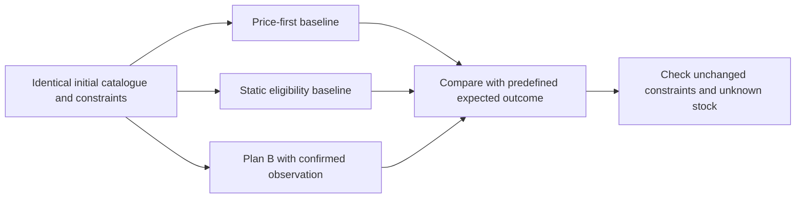

# Evaluation and evidence

[← Documentation](README.md) · [Architecture](architecture.md) · [Live state](insured-vibe-coding/kanban.md)

**The strongest supported claim is correct, visible recovery in the exercised scenarios—not a proven real-world purchase-success rate.** Recorded results distinguish deterministic fixtures, real catalogue queries, genuine model calls, rendered interaction and local container checks.

## Evidence map

| Layer | Recorded outcome | Evidence | What it does not establish |
|---|---|---|---|
| Backend regressions | 186 passing tests at the reviewed code checkpoint | [Progress and checkpoints](implementation-progress.md) | A fresh test run on every later documentation commit |
| Independent rendered UI | 23/23 scenarios | [UI ledger](insured-vibe-coding/test-plans/shopping-ui.md), [raw results](qa-evidence/shopping-ui.json) | Hosted mobile acceptance |
| Mission API | 20/20 actual API scenarios | [Cases](insured-vibe-coding/test-plans/mission-api.md), [results](qa-evidence/mission-api.json) | A genuine seller conversation |
| Model runtime | 12/12 independent real runtime QA scenarios | [Runtime ledger](insured-vibe-coding/test-plans/model-runtime.md), [results](qa-evidence/model-runtime.json) | Uninterrupted cloud inference |
| Catalogue queries | 20 query scenarios, 60 warm samples; recorded warm-search p95 about 69.5 ms | [Catalogue evaluation](qa-evidence/catalogue-evaluation.json) | A production latency guarantee or network-inclusive response time |
| Recovery | 8/8 synthetic adversarial cases; source-row scenario shows +300,000 toman | [Recovery results](../results/recovery.json) | Random-sample accuracy, live stock or user-study action savings |
| Container | Constrained local container, private-path checks and restart persistence | [Container evidence](qa-evidence/container.json), [artifact manifest](qa-evidence/deployment-artifact.json) | Actual Liara hosting |

These are historical recorded checks. Follow [verification commands](getting-started.md#verification-commands) to run appropriate checks against another revision/environment. Genuine model evaluations consume the persistent shared budget.

## What the recovery evaluation asks

The eight cases exercise seller unavailability, no response, price increase, variant mismatch, payment conflict, incompatible opening hours, unknown opening hours and exhausted unanswered shops. Expected outcomes are defined independently of planner output.

| Approach | Rule | Important limitation |
|---|---|---|
| Price-first | Select the cheapest recorded offer | Ignores initial eligibility and later information |
| Static-eligible | Select once from initially eligible offers | Does not process subsequent seller replies |
| Plan B | Re-evaluate after a confirmed scoped observation | Tested on designed cases, not a representative user population |

The comparison isolates the value of updating a plan. It is not evidence that this product outperforms every shopping assistant. Fixture protocol action counts are not measured human effort, and small in-process timing values are not browser/network latency.

## Source-row demonstration

The recorded real-catalogue fixture uses the exact product ID and offer IDs retained in [recovery.json](../results/recovery.json). The independent fallback is approximately **63.4 m** away straight-line; promoting it changes price from **39.2M** to **39.5M** toman. The recorded confirmation/replan measurement is about **20 ms** in that specific local run. Seller replies are simulated and stock remains unknown.

## What remains open

- [ ] Actual public HTTPS deployment and hosted-worker roundtrip.
- [ ] Hosted disconnect/reconnect, privacy and mobile acceptance.
- [ ] Narrated public video and one-time final contest submission.

The [submission record](../submission.md) owns final links/confirmations. Local success is not used to close these gates.
