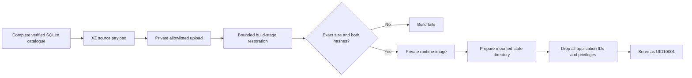

# Private source packaging

[← Documentation](README.md) · [Deployment](deployment.md) · [Artifact manifest](qa-evidence/deployment-artifact.json)

The complete supplied catalogue remains mandatory. A source upload that exceeds the provider limit is corrected by changing its transport representation, never by removing catalogue rows or substituting fixtures.

## Default XZ format and integrity

| Concern | Contract |
|---|---|
| Complete data | XZ preserves the original SQLite bytes; restored size/hash and actual table counts are verified |
| Private upload | Explicit allowlist includes Dockerfile, locked requirements, backend, compiled frontend, compressed catalogue/manifest and two build/startup helpers |
| Excluded inputs | No environment, authentication, mission state, personal records or general workspace directory; default XZ mode also excludes the source ZIP |
| Source limit | Packager rejects an artifact above the conservative decimal bound recorded in its manifest before replacing the destination |
| Decoder memory | One-MiB chunks and a64-MiB decoder memory limit; no full database loaded into Python memory |
| Incorrect/truncated payload | Compressed hash, decoded size and decoded hash must all match; trailing bytes fail; atomic output replacement preserves any prior destination on failure |
| Runtime database | Read-only full SQLite copied from a separate build stage; compressed build inputs do not become runtime data files |
| Cache | Reuse requires the current source hash, byte count and compressed-file hash; source changes or corrupt cache trigger regeneration |

`scripts/package_deployment.py` prepares the compressed inputs and a mode0600 private source archive. `scripts/build_image.sh` invokes that preparation before its Docker build. Generated catalogue files and deployment archives remain Git-ignored. Do not publish the image or these archives to a public registry.

The manifest owns exact artifact bytes, source/restored hashes and member names. [Packaging repair evidence](qa-evidence/packaging-repair.json) records the provider rejection, local build measurements and actual archive-input verification. A local pass does not claim that the provider accepted or deployed the source; [deployment](deployment.md) owns those separate results.

## Persistent state and privilege drop

An empty cloud disk can be root-owned even though a Docker named volume inherits the image directory’s ownership. The former was reproduced as an actual startup database-permission failure before adding the initializer.

The entrypoint briefly prepares **only the `/data` directory descriptor**, refuses a symlink and does not recursively take ownership of files. It clears supplementary groups, sets all real/effective/saved UID/GID values to10001, enables irreversible `no_new_privs`, and only then executes the application. Application PID1 is verified with UID/GID10001, zero effective capabilities and `NoNewPrivs:1`. No model authentication is copied into the image.

The initializer supports the new dedicated empty state disk. It does not silently repair arbitrary inherited root-owned files. That case requires deliberate owner maintenance rather than a recursive ownership change.

## Acceptance evidence

| Environment | Checks |
|---|---|
| [Named volume](qa-evidence/container-xz-named.json) |512MiB/0.5CPU; actual complete catalogue/hash/counts; readiness, search, recovery, restart persistence and private-path404 |
| [Initially root-owned bind](qa-evidence/container-xz-root-bind.json) | Same checks, bounded state-directory preparation, actual unprivileged PID1 and byte-identical frozen frontend delivery |
| [Artifact inspection](qa-evidence/packaging-repair.json) | Every actual archived input matched the context used for the successful image; raw SQLite is replaced by its compressed transport form |

The application and compiled UI were kept frozen throughout this packaging repair. No seller communication, model call, provider-resource mutation or public image publication belongs to these local checks.

## Provider legacy-builder compatibility

The provider completed source restoration and dependency installation, then rejected BuildKit-only `COPY --chmod` syntax. Both copies now use ordinary Docker syntax followed by explicit permission-setting in `RUN`. This keeps the same complete catalogue, immutable0444 files and bounded state initializer without requiring a provider setting change.

An actual `DOCKER_BUILDKIT=0` build reproduced the original failure and completed all20steps after the narrow fix. Fresh named-volume and root-owned-bind acceptance ran against that legacy-built image. [Compatibility evidence](qa-evidence/packaging-legacy-compatibility.json) owns the new private artifact hash, complete local logs and acceptance references. The previous failed archive is retained separately. No successful provider deployment is implied by this local result.

## Complete CSV ZIP build mode

An explicit `--source-zip` option packages the original complete private organizer ZIP instead of the generated XZ database. `Dockerfile.csv-source` becomes `Dockerfile` inside that package; the default Dockerfile/XZ mode remains unchanged for reproduction. The alternate build stage runs the existing hash-validating ingester and creates the same full runtime catalogue. The runtime image receives only that database, not the ZIP, source manifest or import script. Application source, compiled frontend, exact-money/planning contracts and the existing privilege-drop/state behavior remain unchanged.

ZIP mode validates all three authoritative CSV payload hashes and records the exact original archive hash, reads only held no-follow regular-file descriptors through validated parent directories, rejects output/report aliases by path and inode, uses exclusive random temporary files and a fixed private ZIP member name, and verifies every input identity and content hash before atomic publication. It includes no credentials, mission state or arbitrary repository files. Use a separate `--report` path so recording this artifact does not overwrite an earlier deployment record. All generated files remain private and Git-ignored; neither the catalogue-containing image nor the original ZIP is for a public registry.

The database's metadata includes measured import duration. SQLite physical layout can also differ between library versions, so a rebuild gets its own binary SHA-256 rather than claiming byte identity with an earlier database. `scripts/compare_catalogues.py` reads both databases without modification and compares canonical ordered digests of every SQL column in shops/products/offers/FTS, all schema/index definitions and source metadata. Only `duration_seconds` is excluded. Row counts alone are insufficient.

The private archive and build-stage manifest prove source identity and complete data; constrained image/API acceptance proves runtime behavior. Their results are owned by `qa-evidence/csv-source/` and `insured-vibe-coding/test-plans/csv-source-packaging.md`. This is a distinct packaging/build contract, not an idempotent retry or reconciliation of any upload whose response was lost. A retained unknown/unreleased upload remains unknown; root delivery owns new provider intents and actual hosted acceptance.
