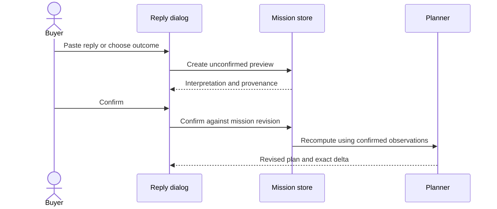

# User guide

[← Documentation](README.md) · [Run locally](getting-started.md) · [Record the demo](demo.md)

**Keep the product and requirements; change the plan when the facts change.** Plan B is a purchase workspace, not a guarantee that a seller has stock.

## Screen map

| Area | Main controls | What changes |
|---|---|---|
| Product discovery | Search, category, comparison, AI needs box | Retrieved products and proposed conditions |
| Purchase conditions | Budget, radius, Tehran visit time, coordinates and payment requirement | The plan only after explicit application |
| Purchase notebook | Selected product, primary, nearby fallback and excluded sellers | Eligibility based on known conditions and confirmed reports |
| Reply dialog | Inquiry draft, pasted reply, manual outcome, preview, confirm | A stored observation, then the revised plan |
| Destination and history | Torob search, Get there, recorded deltas | Handoffs follow the current primary |

On desktop, discovery is on the right and the purchase notebook on the left. On mobile they stack; selecting a product brings its mission into view.

## Choose a product

1. Start with the leading assistant composer. For direct search, expand **جست‌وجوی مستقیم و فیلترها**, enter a model/name in **جست‌وجوی کالا**, then press **جست‌وجو**.
2. For help choosing, describe the need in the assistant box and press **کمک برای انتخاب**. Inspect **چرا این گزینه؟** for recorded evidence.
3. Tick **مقایسه** on two cards and open **مقایسه دو کالا**. Missing specifications are unknown, not proof of absence.
4. Use **انتخاب این کالا** to choose the exact variant. Another variant is not silently substituted later.

For a selected product, **شرایط همین کالا** can propose a budget, radius, visit time or payment change; the full proposed values are shown before confirmation. Relative dates resolve against an explicit Tehran clock. A selected-product condition update uses one model interpretation call and a deterministic eligibility summary rather than recommending the same product again.

An AI proposal is explicitly labelled **پیشنهاد؛ هنوز اعمال نشده**. **استفاده از پیشنهاد** requires your action; changing an existing mission's conditions is explicit as well.

## Set the conditions

Expand **جست‌وجوی مستقیم و فیلترها** to edit conditions. Use budget in **toman**, radius in kilometres and **Tehran** visit time. Expand **محدوده و شرایط پرداخت** for coordinates, the Jomhouri shortcut, location permission and payment requirements. Use **اعمال شرایط روی همین برنامه** after editing an existing mission.

| Label or fact | Interpret it as |
|---|---|
| Recorded price | Historical data, not a current quotation |
| Stock unknown | No live inventory confirmation |
| Compatible declared hours | The supplied schedule covers the visit, not a promise the shop is open |
| Straight-line distance | Geometry, not walking distance or journey duration |
| Recorded payment support | Shop data, not a credit decision for the buyer |
| No eligible option | A real gap under current conditions; choose any relaxation yourself |

## Practice the complete recovery

### A. Load the sample

Click **دیدن سناریوی نمونه**. It loads the exact catalogue product, a fixed **22 October 2026 at 20:15 Tehran**, a **40,000,000-toman** ceiling and **1 km** radius.

Primary: **39,200,000** toman. Nearby fallback: **39,500,000** toman at another shop about **63.4 m** from the primary. This separation differs from the distance each card shows from your selected origin. The dataset's product wording does not independently establish branded-product authenticity.

Expand **چه چیزهایی نیازمند بررسی‌اند؟** to see why offers fail eligibility. The cheapest recorded offer misses the sample visit's declared opening hours.

### B. Review the reply

On the primary card, click **بررسی پاسخ فروشنده**. The inquiry asks about exact model, price, stock and visit time. The product does not send it. The example has no genuine supplied contact route; synthetic telephone numbers are not offered as actions.

For a simulated unavailable response, paste:

> سلام، این مدل با همین مشخصات فعلاً موجود نیست.

Click **برداشت دستیار از پاسخ** for genuine AI interpretation. Alternatively choose **ناموجود** under **نتیجه بررسی** and click **پیش‌نمایش تغییر**. Inspect the preview before clicking **تأیید پاسخ و بازچینی**.

### C. Inspect the repaired plan

The fallback becomes primary. The visible increase is **300,000 toman**. Product, budget, radius and visit time remain unchanged. Expand **تغییرهای همین برنامه** to review changes.

Click **رفتن به فروشگاه**: the destination follows the new primary. Neshan has a coordinate handoff; Balad, Snapp and Tapsi provide official launches with copyable destination details. No trip is booked. The Torob action searches the chosen model; it does not synchronize fresh offers into this mission.

### D. Demonstrate an honest no-match

After excluding the original primary, lower the budget to **39,400,000** and apply it. The remaining 39.5M option is unaffordable. Explicitly raise the budget to **39,500,000** and apply it to restore eligibility. This is your choice, not an automatic budget overrun.

## Reports, reset and repeat

| Action | Meaning |
|---|---|
| Report unavailable, wrong variant or changed price | A scoped observation for this mission |
| Report no response | Unknown/recheckable, not proof of stock or permanent unavailability |
| Report a closure | Date-scoped information, not a permanent closure claim |
| Confirm a later recheck | Can supersede an earlier report within its scope |
| **بازنشانی شبیه‌سازی** | Clears this simulation's observations; retains edited constraints |
| **دیدن سناریوی نمونه** | Creates a fresh sample mission with the fixed original conditions |
| **شروع برنامه بدون شبیه‌سازی** | Starts a separate assisted mission; does not turn simulation into verified fact |

> [!TIP]
> Use a fresh sample mission for each recording take. Refreshing restores your saved private mission rather than necessarily starting over.

## When AI is unavailable

You can still search, compare, choose products, set conditions, preview manual outcomes and recover the plan. The interface discloses the worker's absence. Canceling an AI request leaves the plan unchanged; stale/late results cannot apply to a newer mission.

[Contact limitations](contact-limitations.md) · [Troubleshooting](reference.md#troubleshooting) · [Evidence and results](evaluation.md)
